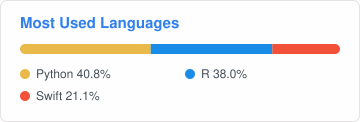

<div align="center">

## Hyojin Park (박효진)

**Data Scientist**

M.S. Statistics, @HUFS

B.S. Statistics, @HUFS



</div>

---

### About

통계학을 바탕으로 데이터를 분석하고, 결과를 이해하기 쉬운 표·그래프·보고서로 전달하는 데이터 사이언티스트입니다.

```r
> str(hyojin)
List of 6
 $ role  : chr "Data Scientist"
 $ base  : chr "Statistics (B.S., M.S.) @ HUFS"
 $ focus : chr [1:3] "Survival Analysis" "Statistical Modeling" "Reporting"
 $ builds: chr [1:2] "R packages for repeated analyses" "small apps with AI coding tools"
 $ tools : chr [1:5] "R" "SQL" "Python" "Claude Code" ...
 $ pet   : chr "콩이 (fat-tailed gecko)"
```

### Experience

- **EvidNet** — Data Scientist (2025.07 ~ Present)
  - 다기관 데이터 분석, 통계 모델링, 시장·마케팅 리서치
- **분당서울대학교병원** — 외부 분석연구원 (2024.10 ~ 2025.06)
  - 대규모 청구 데이터 기반 생존분석
- **HUFS** — 석사 (2024.09 ~ 2026.02)
  - 석사논문: [A novel discrete parametric survival model based on the alternative discrete hazard rate](https://www.riss.kr/search/detail/DetailView.do?p_mat_type=be54d9b8bc7cdb09&control_no=6454e230431be04cffe0bdc3ef48d419)

### Tech Stack


- **Statistics** — Survival Analysis · Cox Regression · Propensity Score · Meta-analysis
- **Data** — SQL · Data QC · Market Research
- **AI / Automation** — Claude Code · Codex · Ollama (Local LLM) · n8n

### Projects

**Research**

| Project | Description | Keywords |
|:---:|:---|:---|
| [Discrete Hazard Model](https://www.riss.kr/search/detail/DetailView.do?p_mat_type=be54d9b8bc7cdb09&control_no=6454e230431be04cffe0bdc3ef48d419) | 석사논문: 이산형 생존자료를 위한 가법 대안 위험률 모형 제안, 실데이터 3종 적용과 시뮬레이션, 전체 재현 코드 | Survival Analysis, MLE, Simulation |

**R Analysis Toolkit** — 반복되는 분석을 테스트와 예제를 갖춘 R 패키지 9종으로

| Project | Description | Keywords |
|:---:|:---|:---|
| Survival Curves | Kaplan-Meier·누적 사건 곡선, risk table, log-rank | Survival Analysis |
| Baseline Table | 군별 기저 특성표, PSM 전후 비교, 서식 있는 Excel 출력 | Table 1, SMD |
| Cohort & Episodes | 대상자 흐름도, 연속 구간 생성, 지속·중단 판정 | Cohort |
| Visualization | 상태 전이 Sankey, 전후 측정값 변화 추이 | ggplot2 |

**Data Tools**

| Project | Description | Keywords |
|:---:|:---|:---|
| Data Quality Check | 기관 간 데이터 품질 비교 | Data QC |
| Disclosure Checker | 데이터 반출 전 Excel·Word의 식별 위험 값 점검 | Privacy |
| Work Studio | 업무 기록·주간 보고·PDF를 한 창에서 | Desktop App |

**AI & Automation**

| Project | Description | Keywords |
|:---:|:---|:---|
| AI Automation Server | 링크를 로컬 AI가 요약해 Notion에 저장 | n8n, Ollama |
| Clipboard AI | 복사한 글을 로컬 AI로 다듬는 메뉴바 앱 | Local LLM |
| Photo Nest | 내 컴퓨터 안에서만 도는 AI 사진 라이브러리 | Local AI |
| Work Memory Plugin | Claude·Codex가 업무 기록을 이어 쓰게 하는 플러그인 | Claude Code, MCP |
| Skill Hub | Claude Code·Codex Skill을 찾고 비교·관리하는 Mac 앱 | Swift |

**Personal Apps**

| Project | Description | Keywords |
|:---:|:---|:---|
| Reptile Care | 팻테일 게코 '콩이'의 다마고치형 사육일지 | TypeScript |
| Local PDF Studio | 내 컴퓨터 안에서만 PDF 합치기·나누기·변환 | Desktop App |
| Project Dashboard | 서버·앱·프로젝트 현황을 한눈에 | Python |

### Contact

- [Email](mailto:blacklaye0322@naver.com)
- [Portfolio](https://app.notion.com/p/Hyojin-Park-Portfolio-3ffca625b3e081caae35c21376fa154e)
<!-- - [LinkedIn](링크드인 주소) -->

---

<div align="center">





<sub>콩이가 잔디를 먹는 중 · 매일 자정 갱신</sub>

</div>
