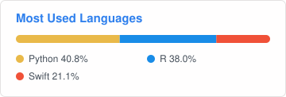
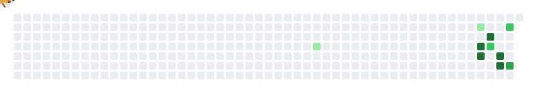

<div align="center">

## Hyojin Park (박효진)

**Data Scientist**

M.S. Statistics, @HUFS

B.S. Statistics, @HUFS




</div>

---

### About

통계학을 바탕으로 데이터를 분석하고, 결과를 이해하기 쉬운 표·그래프·보고서로 전달하는 데이터 사이언티스트입니다.

```r
> str(hyojin)
List of 6
 $ role  : chr "Data Scientist"
 $ base  : chr "Statistics (B.S., M.S.) @ HUFS"
 $ focus : chr [1:3] "Survival Analysis" "Statistical Modeling" "Reporting"
 $ builds: chr [1:2] "R packages for repeated analyses" "small apps with AI coding tools"
 $ tools : chr [1:5] "R" "SQL" "Python" "Claude Code" ...
 $ pet   : chr [1:2] "Kongi (fat-tailed gecko)" "Dubu (chubby white Maltese)"
```

### Experience

```r
> hyojin$experience |> arrange(desc(start))
[[1]] EvidNet · Data Scientist · 2025.07 ~ present
      Multi-site data analysis, statistical modeling, market research
[[2]] Seoul National University Bundang Hospital · External Research Analyst · 2024.10 ~ 2025.06
      Survival analysis on large-scale claims data
[[3]] HUFS · M.S. Statistics · 2024.09 ~ 2026.02
      thesis: A novel discrete parametric survival model
              based on the alternative discrete hazard rate
```

### Tech Stack

```r
> hyojin$tools
$languages
[1] "R"        "SQL"      "SAS"      "R Shiny"  "Python"

$statistics
[1] "Survival Analysis" "Cox Regression"    "Propensity Score"  "Meta-analysis"

$data
[1] "Data QC"           "Market Research"

$ai_automation
[1] "Claude Code"       "Codex"             "Ollama"            "n8n"
```

### Projects

```r
> fs::dir_tree("projects")
projects
├── research
│   └── discrete-hazard-thesis   # M.S. thesis: additive alternative hazard model for discrete survival data
├── r-toolkit                    # 9 R packages with tests and examples
│   ├── survival-curves          # Kaplan-Meier & cumulative incidence curves, risk table, log-rank
│   ├── baseline-table           # Baseline tables by group, pre/post-PSM comparison, Excel output
│   ├── cohort-and-episodes      # Cohort flow diagrams, continuous episodes, persistence/discontinuation
│   └── visualization            # State-transition Sankey, before/after measurement trends
├── data-tools
│   ├── r-masked-workbook        # Auto-generated result workbooks + masking of cells under 5
│   ├── data-quality-check       # Cross-site data quality comparison
│   ├── disclosure-checker       # Scans Excel/Word for identifying values before data export
│   └── work-studio              # Work logs, weekly reports and PDFs in one window
├── ai-automation
│   ├── ai-automation-server     # Local AI summarizes links and saves them to Notion
│   ├── clipboard-ai             # Menu-bar app that polishes copied text with local AI
│   ├── photo-nest               # AI photo library that runs entirely on-device
│   ├── work-memory-plugin       # Plugin that lets Claude & Codex share work history
│   ├── meeting-minutes-docx     # Turns meeting transcripts into formatted Word minutes
│   └── skill-hub                # Mac app to find and manage Claude Code & Codex skills
└── personal-apps
    ├── reptile-care             # Tamagotchi-style care log for Kongi the fat-tailed gecko
    ├── local-pdf-studio         # Merge, split and convert PDFs fully offline
    └── project-dashboard        # Servers, apps and projects at a glance
```

### Contact

```r
> contact(hyojin)
$email
[1] "blacklaye0322@naver.com"

$linkedin
[1] "linkedin.com/in/효진-박-89834b366"
```

[](mailto:blacklaye0322@naver.com)
[](https://billowy-mackerel-e08.notion.site/Hyojin-Park-Portfolio-3ffca625b3e081caae35c21376fa154e)
[](https://www.riss.kr/search/detail/DetailView.do?p_mat_type=be54d9b8bc7cdb09&control_no=6454e230431be04cffe0bdc3ef48d419)
[](https://www.linkedin.com/in/%ED%9A%A8%EC%A7%84-%EB%B0%95-89834b366/)

---

<div align="center">

<picture>
  <source media="(prefers-color-scheme: dark)" srcset="assets/langs-dark.svg" />
  
</picture>

<picture>
  <source media="(prefers-color-scheme: dark)" srcset="assets/gecko-dark.svg" />
  
</picture>

<sub>콩이가 잔디를 먹고 두부가 따라가는 중 · 매일 자정 갱신</sub>

</div>
